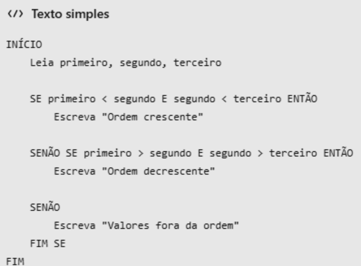

<div align="center">
  
</div>
# 📊 Classificação de Ordem em Python


Solução desenvolvida para o desafio **"Python em Desafios de Lógica para Engenharia de Dados: Classificação de Ordem em Python"**, proposto pela plataforma **Digital Innovation One (DIO)** durante o *Bootcamp de Engenharia de Dados, Inteligência Artificial e Machine Learning (Projeto DataPilot)*.

---

## 📝 Sobre o Projeto

Na Engenharia de Dados, a validação de registros antes de seu envio para pipelines de processamento é essencial para garantir a integridade e a qualidade das informações.

Este projeto implementa um algoritmo simples e eficiente em Python capaz de ler três números inteiros informados em uma única linha e classificar a sequência em **crescente**, **decrescente** ou **desordenada**, aplicando conceitos fundamentais de lógica de programação, conversão de tipos e estruturas condicionais.

---

## 🎯 Regras do Desafio

O programa deve receber exatamente **três números inteiros** separados por espaço e imprimir uma única palavra em letras maiúsculas, seguindo os critérios abaixo:

* **`CRESCENTE`**: Quando o primeiro número for estritamente menor que o segundo e o segundo for estritamente menor que o terceiro ($a < b < c$).
* **`DECRESCENTE`**: Quando o primeiro número for estritamente maior que o segundo e o segundo for estritamente maior que o terceiro ($a > b > c$).
* **`DESORDENADO`**: Em qualquer outra situação, incluindo valores repetidos (iguais) ou sequências parcialmente ordenadas.

---

## 🧠 Lógica e Pseudocódigo

A resolução utiliza comparações lógicas encadeadas e a estrutura condicional `if / elif / else`. Abaixo está a representação estruturada do algoritmo elaborado na documentação técnica:

<div align="center">
  
  <br>
  <em>Quadro 1 - Algoritmo para verificação de ordem numérica. Fonte: Elaborado pela autora (2026).</em>
</div>
---

## 💻 Código-Fonte

Abaixo está o registro visual do código desenvolvido para a solução e, logo em seguida, o código pronto para execução:


```python
# Leitura e conversão dos três valores inteiros
valores = input().split()
primeiro, segundo, terceiro = map(int, valores)

# Verificação da ordem dos elementos
if primeiro < segundo < terceiro:
    print("CRESCENTE")
elif primeiro > segundo > terceiro:
    print("DECRESCENTE")
else:
    print("DESORDENADO")
